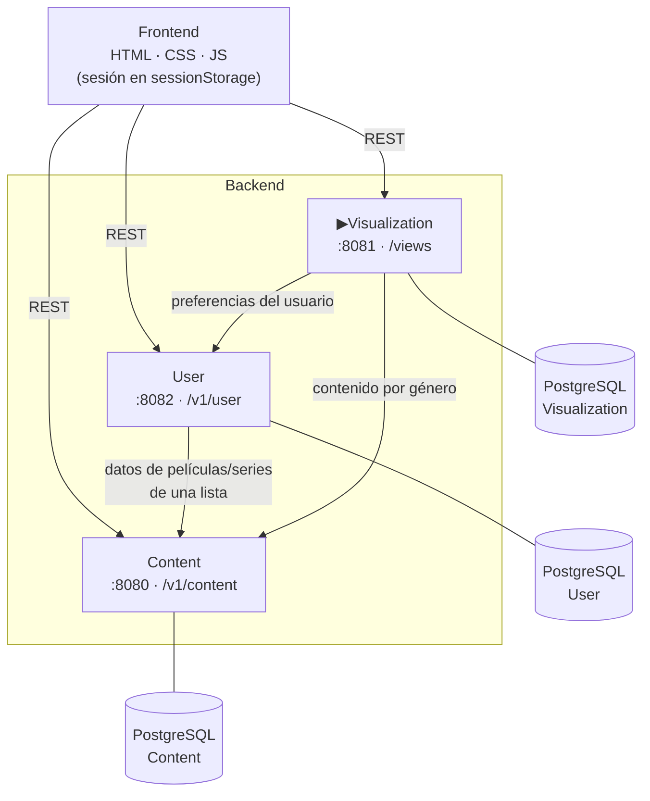

# Ñefli

> Plataforma de streaming inspirada en Netflix, construida con una arquitectura de **microservicios REST en Spring Boot**, bases de datos **PostgreSQL** independientes y un **frontend en HTML, CSS y JavaScript**.

Proyecto académico que permite explorar un catálogo de películas y series, gestionar cuentas de usuario con perfiles, listas y suscripciones, y simular la reproducción de contenido con historial, "Seguir viendo" y recomendaciones personalizadas.

---

## Autores

| Nombre | GitHub | 
|---|---|
| Jesús Moruno Muñozo | [@Jmorunom](https://github.com/Jmorunom) | 
| Adrián Ramos Caballero | [@adrianrc7](https://github.com/adrianrc7) | 
| Samuel Gómez Grande | [@samuelgoomez](https://github.com/samuelgoomez) | 
| Sergio Durán Pérez | [@SergioDP2003](https://github.com/SergioDP2003) | 

---

## Índice

- [Funcionalidades](#funcionalidades)
- [Tecnologías](#tecnologías)
- [Arquitectura](#arquitectura)
- [Microservicios](#microservicios)
  - [Content (8080)](#content--puerto-8080)
  - [User (8082)](#user--puerto-8082)
  - [Visualization (8081)](#visualization--puerto-8081)
- [Modelo de datos](#modelo-de-datos)
- [Frontend](#frontend)
- [Estructura del proyecto](#estructura-del-proyecto)
- [Requisitos previos](#requisitos-previos)
- [Instalación](#instalación)
- [Configuración](#configuración)
- [Puesta en marcha](#puesta-en-marcha)
- [Uso](#uso)
- [Documentación de la API (Swagger)](#documentación-de-la-api-swagger)
- [Pruebas](#pruebas)
- [Solución de problemas](#solución-de-problemas)
- [Limitaciones conocidas](#limitaciones-conocidas)
- [Licencia](#licencia)

---

## Funcionalidades

**Catálogo**
- Listado de películas, series y actores en carruseles.
- Búsqueda por título y filtrado por género o por actor.
- Ficha de detalle de película, serie (con sus episodios) y actor.
- Alta, edición y borrado de películas, series, episodios y actores.

**Usuarios**
- Registro, inicio y cierre de sesión.
- Consulta, edición y borrado de la cuenta.
- Perfiles por cuenta (adulto o infantil).
- Métodos de pago.
- Contratación, consulta y cancelación del plan de suscripción.
- Listas personalizadas a las que se añaden o quitan películas y series.

**Visualización**
- Reproductor simulado: *play*, pausa, fin, cambio de idioma, subtítulos y descarga.
- Historial de visualizaciones del usuario.
- Sección **"Seguir viendo"** con el contenido que se dejó a medias.
- **Recomendaciones** de películas y series basadas en los géneros preferidos del usuario.

> ℹ️ El reproductor no emite vídeo real: registra en el backend el estado de cada visualización (reproduciendo, en pausa, terminado…) y las opciones elegidas.

---

## Tecnologías

| Capa | Tecnología | Versión |
|---|---|---|
| Lenguaje backend | Java | 8+ |
| Framework | Spring Boot (Spring Web, JDBC, Validation) | 2.7.15 |
| Cliente HTTP entre servicios | Spring WebFlux `WebClient` | (incluida en Spring Boot) |
| Diseño de API | OpenAPI 3 + [OpenAPI Generator](https://openapi-generator.tech) | 7.9.0 |
| Documentación de API | springdoc-openapi + Swagger UI | 1.6.14 |
| Base de datos | PostgreSQL | 12+ |
| Acceso a datos | JDBC (`PreparedStatement`) | — |
| Build | Apache Maven | 3.6+ |
| Frontend | HTML5, CSS3 y JavaScript (Fetch API) | — |
| Pruebas de API | Postman | — |

---

## Arquitectura

El sistema se divide en **tres microservicios independientes**. Cada uno tiene su propia base de datos (patrón *database per service*), su propio puerto y su propio contrato OpenAPI. El frontend es un conjunto de páginas estáticas que llaman directamente a los servicios con `fetch`.



### Comunicación entre servicios

| Origen → Destino | Motivo |
|---|---|
| **User → Content** | Al consultar las películas o series de una lista, User solo guarda sus IDs y pide los datos completos a Content. |
| **Visualization → User** | Para recomendar contenido obtiene las `preferences` (géneros favoritos) del usuario. |
| **Visualization → Content** | Por cada género preferido pide a Content el contenido de ese género. |

Estas llamadas se hacen con `WebClient` (Spring WebFlux).

### Arquitectura interna de cada servicio

Los tres servicios siguen el mismo patrón por capas, generado a partir de su `openapi.yaml` (enfoque *API-first*):

```
Petición HTTP
     │
     ▼
api/XxxApi.java              ← Interfaz generada por OpenAPI Generator (rutas, parámetros, docs)
api/XxxApiController.java    ← Implementación: valida y traduce el resultado a ResponseEntity
     │
     ▼
dao/XxxDAO.java              ← Lógica de negocio y SQL (JDBC) + llamadas a otros servicios
     │
     ▼
PostgreSQL
```

- `model/`: POJOs generados a partir de los esquemas OpenAPI (`Film`, `Serie`, `User`, `Profile`…).
- `configuration/`: `DataSource`, `WebClient`, Swagger y la redirección de `/` a Swagger UI.

---

## Microservicios

### Content · puerto `8080`

Gestiona el **catálogo**: películas, series, episodios y actores.
URL base: `http://localhost:8080/v1/content`

| Método | Ruta | Descripción |
|---|---|---|
| `GET` / `POST` | `/films` | Listar todas las películas / crear una película |
| `GET` / `PUT` / `DELETE` | `/films/{filmID}` | Consultar / editar / borrar una película |
| `GET` | `/films/genre/{genreID}` | Películas de un género |
| `GET` | `/films/title/{title}` | Buscar película por título |
| `GET` | `/films/actor/{actorID}` | Películas en las que aparece un actor |
| `GET` / `POST` | `/series` | Listar todas las series / crear una serie |
| `GET` / `PUT` / `DELETE` | `/series/{serieID}` | Consultar / editar / borrar una serie |
| `GET` | `/series/genre/{genreID}` | Series de un género |
| `GET` | `/series/title/{title}` | Buscar serie por título |
| `GET` | `/series/actor/{actorID}` | Series en las que aparece un actor |
| `GET` / `POST` | `/series/{serieID}/episodes` | Episodios de una serie / añadir episodio |
| `GET` / `PUT` / `DELETE` | `/series/{serieID}/episodes/{episodeID}` | Consultar / editar / borrar un episodio |
| `GET` / `POST` | `/actors` | Listar actores / crear actor |
| `GET` / `PUT` / `DELETE` | `/actors/{actorID}` | Consultar / editar / borrar un actor |

### User · puerto `8082`

Gestiona **cuentas, perfiles, pagos, suscripciones y listas**.
URL base: `http://localhost:8082/v1/user`

| Método | Ruta | Descripción |
|---|---|---|
| `GET` | `/users` | Listar todos los usuarios |
| `POST` | `/user` | Registrar un usuario |
| `GET` / `PUT` / `DELETE` | `/user/{userID}` | Consultar / editar / borrar un usuario |
| `GET` | `/user/login?username=&password=` | Iniciar sesión |
| `GET` | `/user/logout` | Cerrar sesión |
| `GET` / `POST` / `DELETE` | `/user/{userID}/payment` | Método de pago |
| `GET` / `POST` | `/user/{userID}/profiles` | Listar / crear perfiles |
| `GET` / `POST` / `DELETE` | `/user/{userID}/profiles/{profileID}` | Consultar / editar / borrar perfil |
| `GET` | `/user/{userID}/getSuscripcionPlan` | Plan de suscripción actual |
| `POST` | `/user/{userID}/hireSuscripcionPlan` | Contratar un plan |
| `DELETE` | `/user/{userID}/cancelSuscripcionPlan` | Cancelar el plan |
| `GET` | `/user/{userID}/lists` | Listas del usuario |
| `POST` | `/user/{userID}/list` | Crear una lista |
| `GET` / `PUT` / `DELETE` | `/user/{userID}/list/{listID}` | Consultar / editar / borrar lista |
| `POST` / `DELETE` | `/user/{userID}/list/{listID}/film/{filmID}` | Añadir / quitar película de la lista |
| `POST` / `DELETE` | `/user/{userID}/list/{listID}/serie/{serieID}` | Añadir / quitar serie de la lista |
| `GET` | `/user/{userID}/list/{listID}/films` | Películas de la lista (datos completos, vía Content) |
| `GET` | `/user/{userID}/list/{listID}/series` | Series de la lista (datos completos, vía Content) |

### Visualization · puerto `8081`

Gestiona las **reproducciones, el historial y las recomendaciones**.
URL base: `http://localhost:8081/views`

| Método | Ruta | Descripción |
|---|---|---|
| `GET` / `DELETE` | `/visualizations/{userID}` | Historial del usuario / borrar historial |
| `POST` | `/visualization/{userID}/{film\|serie}/{id}/play` | Iniciar o reanudar reproducción |
| `POST` | `/visualization/{userID}/{film\|serie}/{id}/pause` | Pausar o reanudar |
| `POST` | `/visualization/{userID}/{film\|serie}/{id}/end` | Marcar como terminado |
| `POST` | `/visualization/{userID}/{film\|serie}/{id}/language` | Cambiar idioma |
| `POST` | `/visualization/{userID}/{film\|serie}/{id}/subtitles` | Activar o desactivar subtítulos |
| `POST` | `/visualization/{userID}/{film\|serie}/{id}/download` | Descargar contenido |
| `GET` | `/visualization/{userID}/continue-watching` | Contenido en "Seguir viendo" |
| `GET` | `/recommendations/film/{userID}` | Películas recomendadas |
| `GET` | `/recommendations/serie/{userID}` | Series recomendadas |

---

## Modelo de datos

Cada microservicio tiene su propia base de datos. Los scripts de creación, que incluyen **datos de ejemplo**, están en la raíz del proyecto.

### Base de datos `Content` — [`Content.sql`](Content.sql)

| Tabla | Campos principales | Notas |
|---|---|---|
| `genres` | `genreID`, `name` | 6 géneros: Acción, Comedia, Drama, Terror, Misterio/Suspense, Infantil |
| `films` | `filmID`, `title`, `genreID`, `releaseYear`, `duration`, `description`, `photoURL`, `arrayActors INT[]` | 20 películas de ejemplo |
| `series` | `serieID`, `title`, `seasons`, `releaseYear`, `genreID`, `description`, `photoURL`, `arrayActors INT[]` | 19 series de ejemplo |
| `episodes` | `episodeID`, `serieID`, `numEpisodio`, `numTemporada`, `titulo`, `photoURL` | FK a `series` con `ON DELETE CASCADE` |
| `actors` | `actorID`, `name`, `birthdayDate`, `photoURL` | 20 actores de ejemplo |

### Base de datos `User` — [`User.sql`](User.sql)

| Tabla | Campos principales | Notas |
|---|---|---|
| `users` | `userID`, `username`, `password`, `email`, `name`, `createdAt`, `preferences INT[]` | `preferences` = IDs de los géneros favoritos |
| `profiles` | `profileID`, `userID`, `name`, `type` (`adult`/`child`), `avatarURL` | |
| `payments` | `paymentID`, `userID`, `cardNumber`, `expirationDate`, `cardHolderName` | |
| `subPlans` | `planID`, `userID`, `startDate`, `endDate`, `paymentID` | |
| `lists` | `listID`, `userID`, `name`, `films INT[]`, `series INT[]` | Guarda IDs de contenido del servicio Content |

### Base de datos `Visualization` — [`Visualization.sql`](Visualization.sql)

| Tabla | Campos principales | Notas |
|---|---|---|
| `visualizations` | `visualizationID`, `userID`, `filmID`, `serieID`, `visualizationDate`, `progreso`, `estado`, `idioma`, `subtitulos` | Un `CHECK` obliga a que cada registro sea de una película **o** de una serie, nunca de ambas |

> Las relaciones entre servicios (por ejemplo, el `filmID` de una lista de usuario) se guardan como IDs sin clave foránea, porque cada servicio tiene su propia base de datos.

---

## Frontend

Aplicación web estática, sin frameworks ni proceso de build:

- **`html/`**: unas 40 páginas, una por pantalla u operación.
- **`js/`**: un script por página, con el mismo nombre que su HTML. Hace las peticiones a los microservicios con `fetch` y pinta los resultados.
- **`css/`**: hojas de estilo (página principal, carruseles, reproductor, perfiles…).
- **`images/`**: logo y recursos gráficos.

La "sesión" se mantiene guardando el `userID` en `sessionStorage` tras iniciar sesión.

### Flujo principal de navegación

```
paginaPrincipalInicial.html ──► iniciarSesion.html / crearCuenta.html
                                         │
                                         ▼
                                 verPerfiles.html
                                         │
                                         ▼
                                paginaPrincipal.html
     ┌───────────────┬───────────────┬───┴───────────┬───────────────┬──────────────┐
     ▼               ▼               ▼               ▼               ▼              ▼
infoPelicula   infoSerie        historial    recomendaciones   seguirViendo   verListas
     │               │                                                         infoCuenta
     ▼               ▼                                                    (pagos, plan…)
reproductor    verEpisodios ──► reproductorSerie
Pelicula
```

---

## Estructura del proyecto

```
proyecto-nyefli/
├── Content/                      # Microservicio de catálogo (puerto 8080)
│   ├── pom.xml
│   └── src/
│       ├── main/java/org/openapitools/
│       │   ├── api/              # Interfaces y controladores REST
│       │   ├── dao/              # Acceso a datos: FilmDAO, SerieDAO, ActorDAO
│       │   ├── model/            # Film, Serie, Episode, Actor
│       │   └── configuration/    # DataSource, Swagger, HomeController
│       ├── main/resources/
│       │   ├── application.properties
│       │   └── openapi.yaml      # Contrato de la API
│       └── test/
├── User/                         # Microservicio de usuarios (puerto 8082)
│   └── ...                       # Misma estructura; UserDAO + WebClientConfig
├── Visualization/                # Microservicio de visualizaciones (puerto 8081)
│   └── ...                       # Misma estructura; VisualizationDAO, RecommendationDAO
├── html/                         # Páginas del frontend
├── js/                           # Lógica del frontend
├── css/                          # Estilos
├── images/                       # Recursos gráficos
├── tests/                        # Colecciones de Postman
│   ├── Content.postman_collection.json
│   ├── User.postman_collection.json
│   └── Visualization.postman_collection.json
├── Content.sql                   # Esquema y datos de ejemplo de la BD Content
├── User.sql                      # Esquema y datos de ejemplo de la BD User
├── Visualization.sql             # Esquema y datos de ejemplo de la BD Visualization
├── .env.example                  # Plantilla de variables de entorno
└── README.md
```

---

## Requisitos previos

| Herramienta | Versión mínima | Comprobar instalación | Descarga |
|---|---|---|---|
| **JDK** | 8 (o superior) | `java -version` | [Adoptium Temurin](https://adoptium.net/) |
| **Apache Maven** | 3.6 | `mvn -v` | [maven.apache.org](https://maven.apache.org/download.cgi) |
| **PostgreSQL** (incluye `psql`) | 12 | `psql --version` | [postgresql.org](https://www.postgresql.org/download/) |
| **Navegador web** | Cualquiera moderno | — | — |
| Postman *(opcional)* | — | — | [postman.com](https://www.postman.com/downloads/) |
| Git *(opcional)* | — | `git --version` | [git-scm.com](https://git-scm.com/) |

### Instalación rápida de requisitos

<details>
<summary><b>Windows</b> (con <code>winget</code>)</summary>

```powershell
winget install EclipseAdoptium.Temurin.17.JDK
winget install Apache.Maven
winget install PostgreSQL.PostgreSQL.16
```

Después de instalar, comprueba que `java`, `mvn` y `psql` están en el `PATH`. Si `psql` no se reconoce, añade `C:\Program Files\PostgreSQL\<versión>\bin` al `PATH`.
</details>

<details>
<summary><b>macOS</b> (con Homebrew)</summary>

```bash
brew install openjdk@17 maven postgresql@16
brew services start postgresql@16
```
</details>

<details>
<summary><b>Linux</b> (Debian/Ubuntu)</summary>

```bash
sudo apt update
sudo apt install openjdk-17-jdk maven postgresql postgresql-contrib
sudo systemctl start postgresql
```
</details>

---

## Instalación

### 1. Clonar el repositorio

```bash
git clone https://github.com/SergioDP2003/proyecto-nyefli.git
cd proyecto-nyefli
```

### 2. Crear las bases de datos

Cada script crea su base de datos, sus tablas y los datos de ejemplo. Ejecútalos desde la raíz del proyecto con el usuario de PostgreSQL:

```bash
psql -U postgres -f Content.sql
psql -U postgres -f User.sql
psql -U postgres -f Visualization.sql
```

Se crearán tres bases de datos: **`Content`**, **`User`** y **`Visualization`**. Puedes comprobarlo con:

```bash
psql -U postgres -c "\l"
```

> ⚠️ Los scripts usan `CREATE DATABASE`. Si las bases de datos ya existen, bórralas antes con `DROP DATABASE "Content";` (y las demás), o la creación fallará.

### 3. Descargar dependencias y compilar

```bash
cd Content       && mvn clean install -DskipTests && cd ..
cd User          && mvn clean install -DskipTests && cd ..
cd Visualization && mvn clean install -DskipTests && cd ..
```

---

## Configuración

Las credenciales de la base de datos **no están en el código**: se leen de variables de entorno.

| Variable | Obligatoria | Valor por defecto | Descripción |
|---|---|---|---|
| `DB_PASSWORD` | **Sí** | — | Contraseña del usuario de PostgreSQL |
| `DB_USERNAME` | No | `postgres` | Usuario de PostgreSQL |
| `DB_URL` | No | `jdbc:postgresql://localhost:5432/<Servicio>` | URL JDBC; cada servicio apunta a su propia BD |

Tienes una plantilla en [`.env.example`](.env.example).

**Definir las variables en la terminal**, antes de arrancar los servicios:

```powershell
# Windows (PowerShell)
$env:DB_PASSWORD = "tu_contraseña"
```

```bash
# macOS / Linux
export DB_PASSWORD="tu_contraseña"
```

**Usar VS Code**: copia `.env.example` como `.env` dentro de cada carpeta de servicio (`Content/.env`, `User/.env`, `Visualization/.env`). La configuración de `.vscode/launch.json` lo carga automáticamente.

> 🔒 El fichero `.env` está en `.gitignore`. **Nunca subas credenciales reales al repositorio.**

El resto de parámetros (puerto, formato de fechas…) están en `src/main/resources/application.properties` de cada servicio.

---

## Puesta en marcha

### 1. Arrancar los microservicios

Abre **una terminal por servicio**, define `DB_PASSWORD` en cada una y ejecuta:

```bash
# Terminal 1 — Content (http://localhost:8080)
cd Content
mvn spring-boot:run
```

```bash
# Terminal 2 — User (http://localhost:8082)
cd User
mvn spring-boot:run
```

```bash
# Terminal 3 — Visualization (http://localhost:8081)
cd Visualization
mvn spring-boot:run
```

> Los servicios pueden arrancarse en cualquier orden. Eso sí, **las recomendaciones y las listas** solo funcionan si los servicios de los que dependen también están levantados.

Como alternativa, se puede ejecutar el `.jar` generado en la instalación:

```bash
java -jar Content/target/openapi-spring-1.0.jar
```

Para comprobar que todo está levantado, abre en el navegador:

- http://localhost:8080/v1/content/films
- http://localhost:8082/v1/user/users
- http://localhost:8081/views/visualizations/1

### 2. Abrir el frontend

El frontend son ficheros estáticos. Hay dos formas de abrirlo:

**Opción A — Abrir el fichero directamente:**
abre `html/paginaPrincipalInicial.html` en el navegador.

**Opción B — Con un servidor estático (recomendado):**

```bash
# Con Python
python -m http.server 5500
# y abre http://localhost:5500/html/paginaPrincipalInicial.html
```

```bash
# Con Node.js
npx serve .
```

También vale la extensión **Live Server** de VS Code (clic derecho sobre `paginaPrincipalInicial.html` → *Open with Live Server*).

---

## Uso

1. Abre la página de inicio y pulsa **Iniciar sesión**.
2. Entra con uno de los usuarios de ejemplo:

   | Usuario | Contraseña |
   |---|---|
   | `toñop123` | `ttpp11` |
   | `cris7` | `ccrr22` |

   También puedes crear una cuenta nueva desde **Crear cuenta**.
3. Elige un **perfil** y accederás al catálogo.
4. Desde la página principal puedes:
   - Buscar películas o series por título.
   - Abrir la ficha de una película, serie o actor.
   - Reproducir contenido (el reproductor registra la visualización).
   - Ver tu **Historial**, **Recomendaciones** y **Seguir viendo**.
   - Gestionar **Mis listas**, **Mis perfiles** y tu **cuenta** (datos, método de pago y suscripción).
   - Registrar nuevas películas, series y actores.

---

## Documentación de la API (Swagger)

Cada servicio publica su documentación interactiva con Swagger UI. Al abrir la raíz del servicio (`/`) se redirige automáticamente a ella.

| Servicio | Swagger UI | Especificación OpenAPI (JSON) |
|---|---|---|
| Content | http://localhost:8080/swagger-ui.html | http://localhost:8080/v3/api-docs |
| User | http://localhost:8082/swagger-ui.html | http://localhost:8082/v3/api-docs |
| Visualization | http://localhost:8081/swagger-ui.html | http://localhost:8081/v3/api-docs |

El contrato original de cada API está en `<Servicio>/src/main/resources/openapi.yaml`.

---

## Pruebas

La carpeta [`tests/`](tests) contiene **colecciones de Postman** con unas 120 peticiones que cubren todos los endpoints, con *scripts* de validación de las respuestas.

**Desde Postman:**
1. *Import* → selecciona los tres ficheros `tests/*.postman_collection.json`.
2. Con los servicios arrancados y las bases de datos recién creadas, ejecuta cada colección con el *Collection Runner*.

**Desde la línea de comandos**, con [Newman](https://www.npmjs.com/package/newman):

```bash
npm install -g newman
newman run tests/Content.postman_collection.json
newman run tests/User.postman_collection.json
newman run tests/Visualization.postman_collection.json
```

> Las pruebas dan por hecho los **datos iniciales** de los scripts SQL y algunas crean o borran registros. Para repetirlas con resultados coherentes, vuelve a crear las bases de datos.

Tests de Maven (solo comprueban que el contexto de Spring arranca):

```bash
cd Content && mvn test
```

---

## Solución de problemas

| Problema | Causa probable | Solución |
|---|---|---|
| `Could not resolve placeholder 'DB_PASSWORD'` al arrancar | No se ha definido la variable de entorno | Define `DB_PASSWORD` en esa terminal (ver [Configuración](#configuración)) |
| `password authentication failed for user "postgres"` | Contraseña incorrecta | Revisa el valor de `DB_PASSWORD` |
| `database "Content" does not exist` | No se ejecutaron los scripts SQL | Sigue el paso [Crear las bases de datos](#2-crear-las-bases-de-datos) |
| `Port 8080 was already in use` | Otro proceso usa el puerto | Cierra ese proceso o cambia `server.port` en `application.properties` (y las URLs del frontend) |
| El frontend muestra "No se pudo cargar…" | Algún servicio no está arrancado | Comprueba que los tres servicios responden (ver [Puesta en marcha](#puesta-en-marcha)) |
| "No se ha encontrado sesión activa" | No hay `userID` en `sessionStorage` | Inicia sesión desde `iniciarSesion.html` |
| `psql: command not found` | PostgreSQL no está en el `PATH` | Añade la carpeta `bin` de PostgreSQL al `PATH` |

---

## Limitaciones conocidas

Al ser un proyecto académico, hay aspectos que **no están preparados para producción**:

- **Autenticación**: no hay tokens ni sesiones en el servidor. La sesión es el `userID` guardado en el navegador y las contraseñas se guardan sin cifrar.
- **CORS** abierto a cualquier origen (`@CrossOrigin(origins = "*")`).
- **URLs de los servicios fijas** (`http://localhost:808x`) en el frontend y en las llamadas entre servicios.
- **Relaciones guardadas en arrays** (`INT[]`) en lugar de tablas intermedias, sin integridad referencial.
- **Datos de pago simulados**: `cardNumber` es de tipo `INTEGER` y no admite números de tarjeta reales.
- El reproductor es **simulado**: no hay emisión de vídeo.

Posibles mejoras: Spring Security con JWT, *hash* de contraseñas (BCrypt), un API Gateway, configuración por entorno, migraciones con Flyway, contenedores con Docker Compose y tests automáticos con JUnit.

---

## Licencia

Este proyecto se distribuye bajo la **licencia MIT**. Consulta [`LICENSE.md`](LICENSE.md).

> **Aviso:** Ñefli es un proyecto **académico, sin ánimo de lucro**. Es una réplica o parodia con fines educativos y **no tiene ninguna relación con Netflix, Inc.**, que no lo patrocina ni lo respalda. "Netflix" es una marca registrada de Netflix, Inc. Algunos elementos de Netflix, como la animación de introducción que aparece al reproducir películas y series, se usan **solo con fines académicos**, para replicar la web original, y **nunca con fines comerciales**. Esos elementos siguen siendo propiedad de Netflix, Inc. y no están cubiertos por la licencia MIT. Los carteles, sinopsis y fotografías de los datos de ejemplo pertenecen a sus respectivos propietarios. Consulta el [aviso legal completo](LICENSE.md#aviso-legal).
